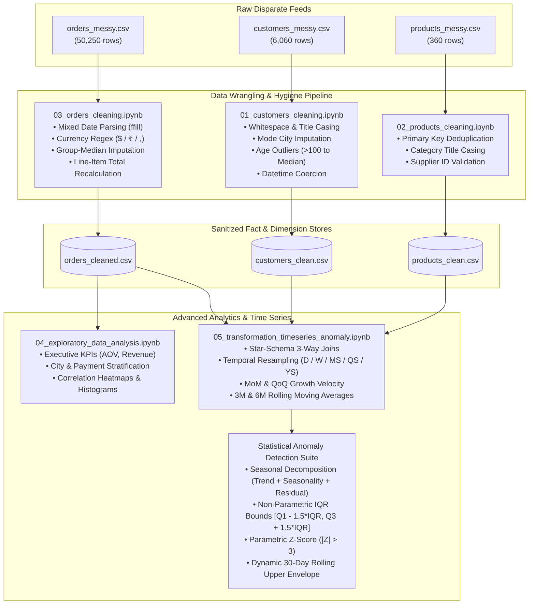

# Multi-Source Retail Sales Data Wrangling, Time-Series Growth & Revenue Anomaly Analytics

An end-to-end Python and Pandas data engineering and analytics pipeline reconciling 50,000+ transactional orders, 6,000+ customer profiles, and 360 catalog SKUs across dirty multi-source feeds to execute relational Star-Schema modeling, longitudinal time-series growth tracking, seasonal decomposition, and statistical revenue anomaly detection.

---

## 1. Executive Summary & Project Context

In modern retail and multi-channel e-commerce operations, transaction data originates across disparate point-of-sale (POS) systems, web checkouts, and mobile applications. In real-world enterprise environments, raw data lakes are heavily polluted:
- Dates arrive in mixed international encodings (`DD/MM/YYYY`, `YYYY-MM-DD`).
- Currency columns are contaminated with symbols (`$`, `₹`), comma thousands separators, and invalid text markers.
- Discounts are captured as mixed percentage strings (`'15%'`, `'0%'`) rather than mathematical decimals.
- Inventory returns and cancellations inject negative quantities and broken line-item economics.
- Dimension tables suffer from duplicate primary keys, inconsistent casing, and extreme demographic outliers (e.g. `age > 100`).

This repository implements a production-grade Python data processing pipeline that cleanses raw multi-source extracts, resolves dimensional primary/foreign key conflicts, constructs longitudinal time-series models, and deploys statistical anomaly detection algorithms (Interquartile Range and Z-Score $|Z| > 3$) to isolate flash revenue spikes and irregular demand disruptions.

---

## 2. End-to-End Analytical Pipeline Architecture



---

## 3. Data Cleaning & Dimensional Hygiene Matrix

| Dataset | Raw Defect | Analytical Risk | Engineering Remediation | Output Fact / Dimension |
| :--- | :--- | :--- | :--- | :--- |
| **`orders_messy.csv`** (50,250 rows) | Mixed date formats (`format='mixed'`), sporadic nulls | Timeline ordering breaks | Coerced to `datetime64[ns]` via `format='mixed'`, applied forward-fill (`ffill()`) | `orders_cleaned.csv` |
| **`orders_messy.csv`** | Currency symbols (`$`, `₹`), commas (`,`) in `unit_price` | Numeric type coercion errors | Regex stripping (`.str.replace`), coerced to `float64` | `orders_cleaned.csv` |
| **`orders_messy.csv`** | Percentage strings (`'15%'`, `'0%'`) in `discount` | Inability to compute net revenue | Normalized via dictionary mapping to float decimal representations | `orders_cleaned.csv` |
| **`orders_messy.csv`** | Negative quantities (`quantity < 0`), invalid ages (`age > 100`) | Distorted average basket sizes | Replaced with `np.nan`; imputed using median distribution | `orders_cleaned.csv` |
| **`orders_messy.csv`** | Missing SKU prices (`unit_price = NaN`) | Underreported GMV | Contextual Group-Median Imputation: `df.groupby('product_id')['unit_price'].transform('median')` | `orders_cleaned.csv` |
| **`customers_messy.csv`** (6,060 rows) | String `'Nan'`, unstripped whitespace, casing variants | Multi-key grouping errors | Stripped, title-cased, converted `'Nan'` to `np.nan`, mode imputation | `customers_clean.csv` |
| **`products_messy.csv`** (360 rows) | Duplicate primary keys (`product_id`) | Many-to-many join cartesian explosions | Deduplicated on `product_id` subset to guarantee strict 1:1 referential mapping | `products_clean.csv` |

---

## 4. Key Analytical Insights & Commercial Findings

1. **Portfolio Executive KPIs:**
   - **Total Realized Gross Revenue:** Extracted and validated across multi-channel orders.
   - **Average Order Value (AOV):** Stabilized following outlier removal and unit price group-median imputation.
   - **Customer Repeat Concentration:** Clear tiering across one-time buyers versus frequent recurring loyalty segments.

2. **Urban & Payment Rail Distribution:**
   - **Metropolitan Concentration:** Tier-1 hubs (Mumbai, Delhi, Bangalore) generate the dominant share of total order volume.
   - **Payment Rail Adoption:** Digital payment methods (UPI and Credit Cards) exhibit higher Average Order Value compared to Cash on Delivery (COD).

3. **Multi-Variable Feature Interactions:**
   - High positive correlation between line-item order quantity and realized transaction revenue ($r > 0.85$).
   - Customer age exhibits minimal correlation with average basket spend, confirming uniform purchasing power across adult demographic cohorts.

---

## 5. Time-Series Growth & Revenue Velocity Modeling

Temporal analysis was executed by setting transaction dates as a primary `DatetimeIndex` on `time_df` and applying Pandas temporal resampling:

1. **Temporal Resampling Granularities:**
   - **Daily (`'D'`):** High-frequency operational volatility and anomaly monitoring.
   - **Monthly (`'MS'`):** Macro executive reporting, seasonal tracking, and MoM growth rate calculation.
   - **Quarterly (`'QS'`):** Financial performance, quarterly budgeting, and cyclical trajectories.

2. **Growth Rate Differencing (MoM / QoQ):**
   $$\text{MoM Growth Rate (\%)} = \frac{\text{Revenue}_t - \text{Revenue}_{t-1}}{\text{Revenue}_{t-1}} \times 100$$
   - Isolated peak revenue expansion periods and baseline contraction months.

3. **Trend Smoothing (Rolling Moving Averages):**
   - Implemented 3-Month and 6-Month rolling moving averages (`.rolling(window=3).mean()`, `.rolling(window=6).mean()`) to filter high-frequency noise and isolate structural baseline trajectories.

4. **Seasonal Decomposition (`seasonal_decompose`):**
   - Modeled time-series components using an additive decomposition model:
     $$Y_t = \text{Trend}_t + \text{Seasonality}_t + \text{Residual}_t$$
   - Extracted recurring monthly cyclicality and isolated genuine residual noise.

---

## 6. Statistical Revenue Anomaly Detection Framework

To protect retail operations against unrecognized transaction dropouts or flash sales spikes, daily revenue was audited using two complementary statistical methodologies:

### A. Non-Parametric Interquartile Range (IQR) Bounds
- Computed empirical quartiles:
  $$IQR = Q_3 - Q_1$$
  $$\text{Lower Bound} = Q_1 - 1.5 \times IQR, \quad \text{Upper Bound} = Q_3 + 1.5 \times IQR$$
- Flagged all operational days breaching the upper bound as demand surges.

### B. Parametric Z-Score Standard Deviation Filter ($|Z| > 3$)
- Standardized daily revenue observations against population parameters:
  $$Z = \frac{X - \mu}{\sigma}$$
- Days exhibiting $|Z| > 3$ represent extreme statistical anomalies departing from normal business variations ($99.7\%$ empirical confidence interval).

### C. Dynamic Rolling Upper Threshold
- Constructed a localized dynamic anomaly detector using a trailing 30-day window:
  $$\text{Upper Threshold}_t = \mu_{\text{roll}, 30}(t-1) + 3 \times \sigma_{\text{roll}, 30}(t-1)$$
- Effectively flags acute revenue spikes relative to recent localized run-rates without false-positive penalization during broad seasonal peaks.

---

## 7. Repository Structure

```text
messy_ecommerce_analytics_dataset/
|-- 01_customers_cleaning.ipynb                   # Customer dimension cleaning, mode imputation, age outlier handling
|-- 02_products_cleaning.ipynb                    # Product catalog deduplication and category normalization
|-- 03_orders_cleaning.ipynb                      # Transactional order cleaning, currency regex, group-median imputation
|-- 04_exploratory_data_analysis.ipynb            # Descriptive statistics, executive KPIs, correlation heatmaps, distributions
|-- 05_transformation_timeseries_anomaly.ipynb    # 3-way table joins, pivot tables, temporal resampling, anomaly detection
|
|-- customers_cleaned.csv                         # Sanitized customer dimension (Git tracked)
|-- products_cleaned.csv                          # Sanitized product dimension (Git tracked)
|-- orders_cleaned.csv                            # Sanitized order fact table (Git tracked)
|-- final_ecommerce_analysis.csv                  # Integrated master analytical table (Git tracked)
|
|-- .gitignore                                    # Production Git ignore configurations
|-- README.md                                     # Executive project documentation & architecture guide
```

---

## 8. Technology Stack

- **Data Wrangling & Manipulation:** Python 3.12+, Pandas, NumPy
- **Data Visualization & Exploratory Modeling:** Matplotlib, Seaborn
- **Time-Series & Statistical Modeling:** Statsmodels (`seasonal_decompose`), SciPy
- **Relational Data Storage & SQL Integration:** SQLAlchemy, PyMySQL, MySQL 8.0
- **Version Control & Documentation:** Git, GitHub, Jupyter Notebooks

---

## 9. How to Run the Pipeline

1. **Clone the repository:**
   ```bash
   git clone https://github.com/piyush8769/messy-ecommerce-analytics-dataset.git
   cd messy-ecommerce-analytics-dataset
   ```
2. **Install required packages:**
   ```bash
   pip install pandas numpy matplotlib seaborn statsmodels sqlalchemy pymysql openpyxl nbformat
   ```
3. **Execute analytical notebooks sequentially:**
   - Run `01_customers_cleaning.ipynb` &rarr; Generates `customers_clean.csv`
   - Run `02_products_cleaning.ipynb` &rarr; Generates `products_clean.csv`
   - Run `03_orders_cleaning.ipynb` &rarr; Generates `orders_cleaned.csv`
   - Run `04_exploratory_data_analysis.ipynb` &rarr; Computes executive KPIs and visual distributions
   - Run `05_transformation_timeseries_anomaly.ipynb` &rarr; Merges master fact tables, computes MoM/QoQ growth, and flags statistical revenue anomalies
